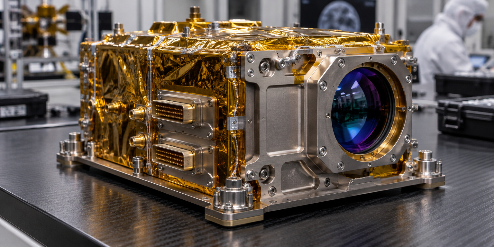

<div align="center">
  
</div>

<p align="center">
  <a href="https://diufoundry.online"></a>&nbsp;
  &nbsp;
  &nbsp;
  
</p>

<p align="center">
  <b>Reaching for the stars with verifiable aerospace telemetry and empirical mission command.</b><br/>
  <em>An interactive mission control workbench simulating deep-space telemetry, satellite network health, and AI incident triage.</em>
</p>

---

## ✦ Mission Overview

The **ISRO Web Experience** is a high-performance mission telemetry console engineered by DIU Foundry. Rather than presenting a static commemorative page, this platform functions as an active mission operations interface—synthesizing orbital trajectories, deep-space communication links, ground station health, and automated anomaly response into a single, cohesive command plane.

```text
 ┌─────────────────────────────────────────────────────────────────────────────┐
 │                           ISRO MISSION CONTROL HUD                          │
 ├─────────────────────┬───────────────────────────────┬───────────────────────┤
 │ SATELLITE TELEMETRY │      NETWORK HEALTH MATRIX    │  AI INCIDENT COMMAND  │
 │ Orbit: Polar / GEO  │ Ground Stations: ISTRAC / DSN │ Anomaly Detection: OK │
 │ Altitude: 384,400km │ Signal Lock: 99.98% Nominal   │ Telecommand: ARMED    │
 └─────────────────────┴───────────────────────────────┴───────────────────────┘
```

---

## 🛰️ Architecture & Dataflow

```text
[ SPACE SEGMENT ]
    │  (S/X-Band RF Downlink · 8.4 GHz)
    ▼
[ GROUND STATIONS (ISTRAC / BYALALU) ]
    │  (Raw Telemetry Frames · CCSDS Packet Stream)
    ▼
[ TELEMETRY INGESTION ENGINE ] ──► [ RECHARTS HUD MATRIX ]
    │                                     │
    ├─► [ NETWORK HEALTH MONITOR ]        ├─► Orbit Parameter Plots
    ├─► [ AI INCIDENT TRIAGE BUS ]        └─► Ground Station Latency
    │           │
    │           ▼
    └─► [ SESSION CONTEXT PROVIDER ] ──► [ OPERATOR INTERFACE ]
```

---

## ✦ Key Systems & Capabilities

- **Interactive Telemetry Dashboard** (`src/pages/Dashboard.tsx`) — Real-time tracking of mission parameters, vehicle states, and orbital mechanics calculations.
- **Ground Station Network Health** (`src/pages/NetworkHealth.tsx`) — Global antenna telemetry, carrier-to-noise ratio ($C/N_0$), and packet error rate diagnostics.
- **AI Anomaly Detection & Incident Analysis** (`src/pages/IncidentAnalysis.tsx`) — Automated telemetry parsing that detects thermal excursions, attitude drift, and power bus voltage drops.
- **Cinematic Operator UI** (`src/components/CursorTrail.tsx`) — Fluid atmospheric transitions, spatial coordinate HUDs, and tactical darkroom color grading.

---

## 🛠️ Project Structure

```text
ISRO/
├── public/                 # Static mission assets & aerospace imagery
├── src/
│   ├── components/         # Mission HUD primitives & telemetry cards
│   │   ├── AppLayout.tsx   # Command navigation & glassmorphic sidebar
│   │   └── CursorTrail.tsx # Atmospheric interactive particle trail
│   ├── data/               # Orbital ephemeris & simulated telemetry logs
│   ├── pages/              # Mission operations views
│   │   ├── Dashboard.tsx   # Primary flight telemetry overview
│   │   ├── NetworkHealth.tsx # Deep-space antenna tracking matrix
│   │   ├── AIIntelligence.tsx # Machine learning telemetry heuristic
│   │   └── IncidentAnalysis.tsx # Anomaly triage & RCA logs
│   ├── session.tsx         # Operator authentication & session state
│   └── App.tsx             # Mission router & global context providers
└── tailwind.config.js      # Custom aerospace slate & solar flare palette
```

---

## ⚡ Quickstart

```bash
# Clone repository
git clone https://github.com/Kishordiu/ISRO.git
cd ISRO

# Install dependencies
npm install  # or bun install

# Launch local mission command console
npm run dev
```

Open [http://localhost:5173](http://localhost:5173) in your browser to inspect the mission control interface.

---

<p align="center">
  <b>RESEARCH → BUILD → TEST → SHIP</b><br/>
  <sub>Engineered with pride by <a href="https://diufoundry.online">DIU Foundry</a> · K. Kishor Kumar</sub>
</p>
